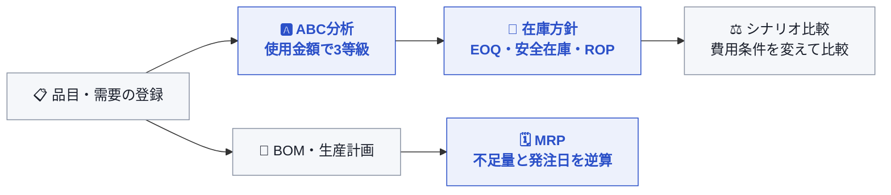

<div align="center">

# 📦 RESTOCK

### 在庫の「いつ・どれだけ発注するか」を、データから計算する

**在庫意思決定シミュレーター ｜ 個人開発 ｜ 朱 韓榮（JU HAN YOUNG）**

[](https://github.com/hanyx-00/restock/actions/workflows/ci.yml)


[한국어 README](README.ko.md)

</div>

---

## 🧭 なぜ作ったのか

大学で **物流学** を専攻し、ABC分析・EOQ・安全在庫・MRP を授業で学びました。<br>
ただ、授業では公式に数字を入れて1回計算するだけで、「需要データが変わったら結果はどう変わるのか」「部品が足りないとき、いつ発注すればいいのか」までは確かめられませんでした。

RESTOCK は、その理論を **実際に動くシステム** として実装した個人プロジェクトです。<br>
品目と過去の需要を登録すると、ABC分析 → 在庫方針 → MRP までが **一つのデータの流れ** としてつながって計算されます。

| | |
| --- | --- |
| 📅 **期間** | 2026.09 |
| 🙋 **担当** | 1人で設計・バックエンド・フロントエンド・CI まで |
| 🧮 **計算** | ABC分析 / EOQ / 安全在庫 / 発注点（ROP）/ MRP / シナリオ比較 |
| ✅ **検証** | サービスのテストと手計算で結果を照合、GitHub Actions で自動チェック |

---

## 🔄 意思決定の流れ



各段階は独立した計算例ではありません。ABC分析の等級が在庫方針のサービス水準を決め、登録した在庫と生産計画が MRP の結果を決めます。ダッシュボードも、登録品目数・総在庫・需要記録数・計画生産量を実際の API データで集計します。

---

## ✨ 主な機能

| 機能 | 実装内容 |
| --- | --- |
| Items | 品目コード、名前、単価、リードタイム、現在庫のCRUD |
| Demand History | 品目別・日付別の需要のCRUD、同じ品目・同じ日付の重複防止、需要推移の可視化 |
| ABC Analysis | 年度別の使用金額と累積比率を計算し、A/B/C等級に分類 |
| Inventory Policy | 実際の需要履歴とABC等級を使い、EOQ・安全在庫・発注点（ROP）を計算 |
| BOM | 完成品と構成品の所要量のCRUD、重複と自己参照の防止 |
| Planned Demand | 品目別の将来の必要日と計画数量のCRUD |
| MRP | 1段階のBOM展開、総所要量・正味所要量・計画入庫量・計画発注日の計算 |
| Scenario Compare | 基準案と代替案の注文費用・保管費用による、EOQ・安全在庫・ROPの比較 |
| Dashboard | 品目、現在庫、需要履歴、生産計画を実際の登録データで集計 |

---

## 🧮 主要な計算ロジック

### ABC分析

品目別の年間使用金額（`年間需要量 × 単価`）を降順に並べ、累積比率で等級を分けます。

- A：累積比率 80% 以下
- B：80% 超 95% 以下
- C：95% 超

### 在庫方針

```text
EOQ = √(2 × 年間需要量(D) × 1回の注文費用(S) / 単位あたりの年間保管費用(H))
Safety Stock = z × 日別需要の標準偏差(σ) × √リードタイム(L)
ROP = 日平均需要 × リードタイム + Safety Stock
```

日別需要の標準偏差は、その年に需要がなかった日を0として含めて計算します。サービス水準とzスコアは、ABC等級に応じて A 99%（2.3263）、B 95%（1.6449）、C 90%（1.2816）を適用します。

### MRP

```text
総所要量（Gross Requirement）       = 完成品の計画数量 × 構成品の単位所要量
正味所要量（Net Requirement）       = max(総所要量 - 現在庫, 0)
計画入庫量（Planned Order Receipt） = 正味所要量
計画発注日（Planned Order Release） = 必要日 - 構成品のリードタイム
```

現在の実装は、1段階のBOMとLot-for-Lot方式を使います。正味所要量が0の場合は発注が不要なため、計画発注日は `null` となり、画面には **発注不要** と表示されます。

---

## 💡 設計のポイント

| ポイント | 内容 |
| --- | --- |
| **お金の計算は `BigDecimal`** | 使用金額・平均需要・EOQ などは `double` ではなく `BigDecimal` と `RoundingMode.HALF_UP` で計算し、丸め方を明示しています |
| **うるう年を考慮** | 日平均需要の分母は固定の365日ではなく、`Year.of(year).length()` でその年の日数を使います |
| **需要0の日も数える** | 需要が記録されていない日を0として標準偏差に含め、需要のばらつきを小さく見積もらないようにしています |
| **ABC等級で基準を変える** | 重要な A 品目ほど高いサービス水準（欠品しにくい安全在庫）を適用します |
| **データの矛盾を入口で防ぐ** | 同じ品目・同じ日付の需要の重複、BOM の自己参照・重複登録はサービス層で拒否します |
| **範囲を絞って正確に** | MRP は1段階 BOM・Lot-for-Lot に絞り、まずは手計算と一致することを優先しました |

---

## 🗓 MRPの例

サービスのテストに含まれているシナリオです。2026-10-01に `PRODUCT-A` が100個必要で、BOMが `MOTOR × 1`、`GEAR × 2`、`BOLT × 8` の場合の結果です。

| 構成品 | 単位所要量 | 総所要量 | 現在庫 | 正味所要量 / 計画入庫量 | リードタイム | 計画発注日 |
| --- | ---: | ---: | ---: | ---: | ---: | --- |
| MOTOR | 1 | 100 | 100 | 0 | 7日 | 発注不要 |
| GEAR | 2 | 200 | 100 | 100 | 5日 | 2026-09-26 |
| BOLT | 8 | 800 | 500 | 300 | 3日 | 2026-09-28 |

MOTORは現在庫ですべてまかなえます。GEARとBOLTは不足分を計画入庫量とし、必要日から各リードタイムを逆算して発注日を示します。

---

## 🛠 技術スタック

| 区分 | 技術 |
| --- | --- |
| Backend | Java 21, Spring Boot 4.1.1, Spring Web MVC, Spring Data JPA, Jakarta Validation |
| Frontend | React 19, TypeScript 6, Vite 8, Tailwind CSS 4, TanStack Query, React Hook Form, Zod, Axios |
| Database | PostgreSQL, H2（テスト） |
| Test / Build | JUnit 5, Mockito, AssertJ, Gradle, ESLint |

---

## 📁 構成

```text
restock/
├─ src/main/java/com/restock/
│  ├─ item, demand              # 基準情報と需要履歴
│  ├─ abc, inventorypolicy      # 分析と在庫方針の計算
│  ├─ bom, planneddemand        # BOMと生産計画
│  └─ mrp, scenario             # 資材所要量計画と方針の比較
├─ src/test/                    # H2の設定とサービスの計算テスト
└─ frontend/src/
   ├─ api, types                # APIクライアントと型
   ├─ components                # 共通UIとレイアウト
   └─ pages                     # 主要な9画面
```

フロントエンドはREST APIを呼び出し、バックエンドはController–Service–Repositoryの各層で、入力の検証・計算・永続化を担当します。

---

## 🔌 API概要

| 領域 | Endpoint | 範囲 |
| --- | --- | --- |
| 品目 | `/api/items` | 登録、全件・1件の取得、更新、削除 |
| 需要履歴 | `/api/demands` | 登録、1件・品目別の取得、更新、削除 |
| ABC分析 | `GET /api/abc?year={year}` | 年度別の使用金額と等級の計算 |
| 在庫方針 | `POST /api/inventory-policies/calculate` | EOQ、安全在庫、ROPの計算 |
| BOM | `/api/boms` | 構成品の登録、親品目別の取得、数量の更新、削除 |
| 生産計画 | `/api/planned-demands` | 登録、全件・1件・品目別の取得、更新、削除 |
| MRP | `GET /api/mrp/planned-demand/{id}` | 生産計画にもとづく資材所要量の計算 |
| シナリオ | `POST /api/scenarios/compare` | 基準案と代替案の方針結果の比較 |

---

## 🚀 実行方法

### 1. Backend

Java 21とPostgreSQLが必要です。PostgreSQLに `restock` データベースを作成し、ルートの `application-secret.example.yml` をコピーして `application-secret.yml` を作成します。

```yaml
app:
  db-password: "your-postgresql-password"
```

既定の接続先は `localhost:5432`、データベース `restock`、ユーザー `postgres` です。パスワードのファイルはGitの追跡対象から除外しています。

```powershell
.\gradlew bootRun
```

### 2. Frontend

```powershell
cd frontend
npm install
npm run dev
```

開発サーバーは `/api` へのリクエストを、既定で `http://localhost:8080` にプロキシします。バックエンドのアドレスが異なる場合は、実行前に `VITE_API_PROXY_TARGET` を指定できます。デプロイなどでAPIの基本パス自体を変える場合は、`VITE_API_BASE_URL` を使います。

---

## 🧪 テストと検証

```powershell
# Backendのテスト
.\gradlew test

# Frontendの静的チェックと本番ビルド
cd frontend
npm run lint
npm run build
```

バックエンドのテストはH2のインメモリデータベースを使うため、ローカルのPostgreSQLとは切り離して実行されます。サービスのテストでは、在庫方針の計算、MRPの展開、シナリオの差分、エラー条件を検証しています。フロントエンドの `build` は、TypeScriptのチェックのあとにViteの本番バンドルを生成します。

### GitHub Actionsによる自動チェック

[CIワークフロー](./.github/workflows/ci.yml)では、`main` ブランチへのpushとPull Requestごとに次を実行します。

- **Backend（Java 21）**：`./gradlew test --no-daemon` でJUnitテストを実行。テスト用H2を使用するため、外部PostgreSQLの接続情報は不要です。
- **Frontend（Node.js 22）**：`npm ci` → `npm run lint` → `npm run build` を実行し、静的チェックとTypeScript・本番ビルドを確認します。

CIのテストが通っても、実際のPostgreSQL接続・本番環境での運用・性能まで検証したことにはなりません。実行状況は[Actionsページ](https://github.com/hanyx-00/restock/actions)で確認できます。

---

## 🔭 現在の範囲と今後の改善

学習の範囲を明確にするため、MRPは1段階のBOM、Lot-for-Lot、現在庫の差し引きに絞りました。次の段階では、以下の機能を拡張できます。

- 多段階BOMの展開と循環参照の検出
- 入荷予定（Scheduled Receipt）と期間ごとの在庫繰り越しの反映
- 固定発注量・最小発注量などのロットサイズ方針の追加
- データ規模の増加に備えたフロントエンドのcode splitting
- Flywayによるデータベーススキーマのバージョン管理

---

<div align="center">

**朱 韓榮（JU HAN YOUNG）** ・ バックエンドエンジニア志望<br>
📫 a98220919@gmail.com ・ 🐙 [github.com/hanyx-00](https://github.com/hanyx-00)

</div>
